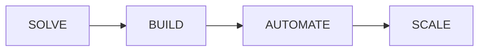

# SOLVIXBIT — Brand System & Positioning Guide

**Brand Name:** SOLVIXBIT  
**Tagline:** Technology That Solves.  
**Core Principle:** Solve first. Build with purpose. Scale with confidence.  
**Document Version:** 1.0.0 (Phase 1: Content & Positioning Foundation)  

---

## 1. Executive Brand Overview

| Dimension | Specification |
|---|---|
| **Company Name** | SOLVIXBIT |
| **Tagline** | Technology That Solves. |
| **Industry** | Technology Solutions, Software Engineering & Digital Transformation |
| **Core Mantra** | *Solve first. Build with purpose. Scale with confidence.* |

---

## 2. Brand Positioning

> **SOLVIXBIT is a technology solutions company helping businesses build, automate and scale through software engineering, AI, SaaS, ecommerce, mobile applications and digital transformation.**

SOLVIXBIT bridges the gap between high-level business problems and practical, scalable technical execution. Rather than building software for the sake of complexity, SOLVIXBIT starts with the problem to be solved, applies intelligent modern technology, and delivers sustainable business outcomes.

---

## 3. Mission & Vision

### Mission
> **To help businesses solve meaningful problems through intelligent, scalable and practical technology.**

### Vision
> **To become a globally trusted technology partner that transforms complex business challenges into simple, scalable digital solutions.**

---

## 4. Brand Personality & Tone of Voice

The SOLVIXBIT brand voice communicates authority, clarity, and genuine problem-solving capability across all touchpoints:

| Trait | How It Manifests in Communication |
|---|---|
| **Intelligent** | Data-driven, analytically sound, technically sharp without being unnecessarily verbose. |
| **Modern** | Forward-thinking, embracing state-of-the-art tech, clean and contemporary framing. |
| **Confident** | Clear, decisive, results-oriented, backed by engineering competence. |
| **Practical** | Grounded in real-world business outcomes, avoiding buzzwords and vaporware. |
| **Reliable** | Dependable, robust, transparent, delivering enterprise-grade quality. |
| **Ambitious** | Focused on growth, scale, and elevating client capabilities to market leaders. |
| **Human** | Approachable, collaborative, empathetic to user and client challenges. |

---

## 5. Primary Messaging Pillars

Every piece of copy, feature, service, and case study aligns with four primary messaging pillars:

1. **Solve**
   - *Theme:* Problem diagnosis, architectural strategy, and intelligent solution design.
   - *Key Focus:* Understanding root business challenges before writing a single line of code.

2. **Build**
   - *Theme:* High-performance software engineering, modern web/mobile applications, and SaaS.
   - *Key Focus:* Clean code, modern stacks, resilient architecture, and purpose-driven development.

3. **Automate**
   - *Theme:* AI integration, intelligent workflows, and system optimization.
   - *Key Focus:* Eliminating operational friction, reducing manual bottlenecks, and accelerating workflows.

4. **Scale**
   - *Theme:* Cloud infrastructure, high-concurrency systems, and scalable digital expansion.
   - *Key Focus:* Sustainable growth, enterprise reliability, security, and long-term performance.

---

## 6. Primary Services Matrix

| Service | Description & Value Deliverable |
|---|---|
| **Software Engineering** | Custom enterprise software, robust backend architectures, APIs, and mission-critical applications engineered for speed, security, and maintainability. |
| **AI & Automation** | Intelligent AI agents, machine learning integrations, workflow automation, and custom predictive models that drive business efficiency. |
| **SaaS & Digital Products** | End-to-end SaaS product development, multi-tenant architectures, subscription platforms, and high-converting product interfaces. |
| **Web & Ecommerce** | Modern web platforms, headless commerce solutions, high-conversion storefronts, and performant web applications. |
| **Mobile Applications** | Native and cross-platform mobile apps (iOS & Android) designed for seamless user experiences and real-time synchronization. |
| **Cloud & Integrations** | Cloud infrastructure setup, DevOps automation, microservices, third-party API orchestrations, and legacy system modernization. |

---

## 7. Reference Guidelines for Future Phases

- **Copywriting:** Use the brand pillars (`Solve`, `Build`, `Automate`, `Scale`) as structural anchors for homepage sections and service cards.
- **Service Listings:** Always maintain the standardized 6 core service categories.
- **Visuals & Design:** Future design phases will build upon these positioning principles to craft visual hierarchy, interactive demos, and messaging flows without altering the core brand truths established here.
