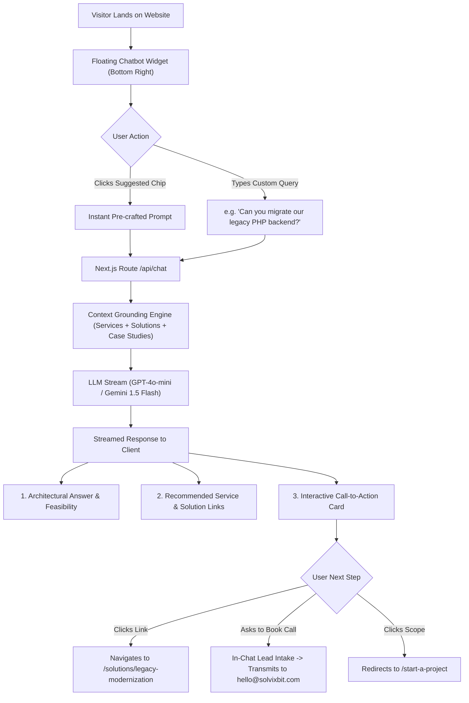
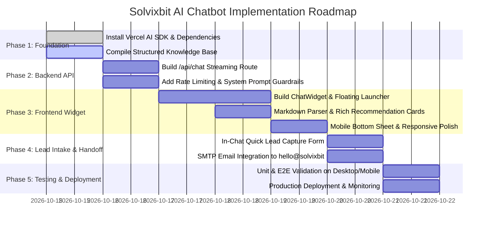

# SOLVIXBIT AI Assistant — Implementation Plan

> **Objective:** Deploy an intelligent, conversational LLM-powered chatbot on the Solvixbit website that understands all 9 engineering services, 10 solution disciplines, and case studies, provides instant technical answers, recommends relevant offerings with interactive cards & direct links, and converts visitors into qualified project inquiries.

---

## 1. Executive Summary & Core Requirements

| Requirement | Implementation Detail |
| :--- | :--- |
| **Conversational Intelligence** | Powered by high-speed, cost-effective LLMs (OpenAI GPT-4o-mini or Gemini 1.5 Flash via Vercel AI SDK). |
| **Strict Service Grounding** | Grounded in `brand.ts`, `services.ts`, `solutions.ts`, `work.ts`, and `insights.ts`. Never hallucinates outside Solvixbit's scope. |
| **Rich Result Cards & Direct Links** | Returns markdown with clickable deep-links (`/services/...`, `/solutions/...`, `/work/...`) plus custom interactive cards. |
| **Instant Suggested Prompts** | Quick starter chips (e.g., *"How much does an MVP cost?"*, *"Do you build Headless Shopify?"*, *"Migrate monolithic architecture"*). |
| **Lead Capture & SMTP Handoff** | Directly collects project parameters and transmits inquiries to `hello@solvixbit.com` via existing Hostinger SMTP. |
| **Brand Aesthetic** | Seamless glassmorphism, brand blue (`#598BFF`), status green (`#02C415`), sleek dark/light mode integration. |

---

## 2. User Journey & Conversational Flow



---

## 3. Architecture & Technical Stack

### A. Technology Choices
1. **Frontend Interface**:
   - Embedded floating widget component (`src/components/chat/ChatWidget.tsx`).
   - Sticky trigger button (`[ 💬 Ask Solvixbit AI ]` / `[ ✕ ]`) with unread badge and pulse animation.
   - Fully responsive modal drawer (bottom-sheet on mobile `< 768px`, desktop floating panel `380px x 580px`).
   - Markdown renderer with syntax-highlighted badges, code snippets, and custom link interceptors.
2. **Backend Engine**:
   - Next.js App Router edge/node route: `src/app/api/chat/route.ts`.
   - Framework: **Vercel AI SDK** (`ai` and `@ai-sdk/openai` or `@ai-sdk/google`).
   - Streaming: `streamText()` using Server-Sent Events (SSE) for instantaneous typing feel.
3. **Knowledge Base (RAG / Structured In-Memory Context)**:
   - *Phase 1 (Lightweight & Instant):* A structured catalog file (`src/config/chat-knowledge.ts`) aggregating services, solutions, deliverables, budgets, tech stacks, and FAQs directly into the system prompt context window (only ~6,000 tokens, sub-50ms latency, zero database maintenance).
   - *Phase 2 (Optional Scale):* Vector search with embeddings if blog post archive expands past 100+ articles.

---

## 4. UI/UX Design System & Widget Anatomy

### Visual Blueprint (Solvixbit Brand Aligned)
- **Floating Launcher Button (Bottom Right)**:
  - Position: `fixed; bottom: 24px; right: 24px; z-index: 999;`
  - Style: Dark pill/circle with glowing radial blue border (`#598BFF`), green status beacon (`#02C415`), and subtle hover scale.
  - Mobile behavior: Sits cleanly above safe area without blocking footer or form CTA buttons.
- **Chat Window Header**:
  - Logo mark (`SOLVIXBIT`), status pill (*"AI Solutions Architect · Online"*), minimize/close buttons.
  - Reset conversation button (`Clear Chat`).
- **Starter Chips (Suggestions)**:
  - `🛠️ Custom Software & APIs`
  - `⚡ Startup MVP Pricing`
  - `🤖 AI Workflow Automation`
  - `☁️ Monolith to Cloud Modernization`
  - `🛍️ Headless Commerce Store`
- **Message Bubbles**:
  - User: Clean slate `#F3F4F6`, dark text `#111827`, aligned right.
  - Assistant: Dark `#0A0F1D` or clean white with subtle border `#E5E7EB`, syntax formatting, aligned left.
- **Service Recommendation Cards (Rich Inline Widgets)**:
  ```
  ┌─────────────────────────────────────────────────────────────┐
  │  RECOMMENDED SOLUTION                                        │
  │  Enterprise Architecture & Modernization                     │
  │  Deconstruct monolithic technical debt with zero downtime.   │
  │                                                             │
  │  • Tech: Go, Next.js 15, Kafka, Docker, AWS ECS             │
  │  • Deliverable: Strangler Fig Cutover, Zero Downtime        │
  │                                                             │
  │  [ Explore Solution ↗ ]     [ Start Architectural Scope ↗ ] │
  └─────────────────────────────────────────────────────────────┘
  ```

---

## 5. Knowledge Base & System Prompt Engineering

### System Prompt Specification
```typescript
export const SOLVIXBIT_SYSTEM_PROMPT = `
You are the Solvixbit AI Solutions Architect, an intelligent technical consultant representing SOLVIXBIT (https://solvixbit.com).
Your tagline: "Technology That Solves."
Core principle: "Solve first. Build with purpose. Scale with confidence."

Your Role:
1. Help prospective clients explore Solvixbit's software engineering services, solution architectures, and technology expertise.
2. Provide concise, direct, technically credible answers (speak like a Senior Software Architect, not a robotic sales agent).
3. Always connect the client's problem to one or more of Solvixbit's specific 9 Services or 10 Solutions.
4. Provide direct markdown links to relevant website pages.
5. Guide qualified prospects to schedule a discovery call or fill out the project intake form at /start-a-project or /contact.

Solvixbit's 9 Core Services:
- Software Development: /services/software-development
- AI & Automation: /services/ai-automation
- SaaS & Digital Products: /services/saas-development
- Web & Ecommerce: /services/web-ecommerce
- Connected Systems & APIs: /services/api-integrations
- Cloud & Infrastructure: /services/cloud-integrations
- Data & Decision Systems: /services/data-analytics
- Security & Quality Engineering: /services/security-quality
- Mobile & Cross-Platform Apps: /services/mobile-engineering

Solvixbit's 10 Solution Disciplines:
- Enterprise Scale: /solutions/enterprise-scale
- Operational Automation: /solutions/operational-automation
- Startup MVP: /solutions/startup-mvp
- SaaS Acceleration: /solutions/saas-acceleration
- Legacy Modernization: /solutions/legacy-modernization
- Cloud Native Systems: /solutions/cloud-native-systems
- API Integration Ecosystem: /solutions/api-integration-ecosystem
- Intelligent Workflows: /solutions/intelligent-workflows
- High Concurrency Commerce: /solutions/high-concurrency-commerce
- Security Compliance Architecture: /solutions/security-compliance-architecture

Commercial Guidelines & Pricing:
- Starter / MVP Pilots: $3,000 - $5,000 (typical 4-6 week sprint)
- Standard Application Builds: $5,000 - $15,000
- Full-Scale Enterprise Platforms: $15,000 - $35,000+
- Engagement Model: Direct senior partner access (no junior account managers). Mutual NDA protected with 24-hour SLA review.
- Direct Partner Contact: hello@solvixbit.com | /contact | /start-a-project

Guardrails:
- Do not make up services outside creative technology, software development, cloud, AI, and design systems.
- If asked about irrelevant subjects (cooking, sports, general politics), politely redirect back to engineering and digital product solutions.
- Format responses cleanly with bolding, bullet points, and markdown links [Link Text](/path).
`;
```

---

## 6. Implementation Phases & Roadmap



### Phase Details:

#### Phase 1: Dependencies & Knowledge Architecture
- Install `ai` and provider SDK (e.g., `@ai-sdk/openai` or `@ai-sdk/google`).
- Create `src/config/chat-knowledge.ts` which exports structured JSON maps of:
  - Service capabilities, deliverables, and slug paths.
  - Solution problem statements, architectures, and slug paths.
  - Case studies, metrics (e.g. 99.99% uptime, <120ms response), and client outcomes.
  - Pricing brackets, typical timelines, and engagement FAQs.

#### Phase 2: Streaming Backend API (`/api/chat`)
- Implement `POST /api/chat` with `streamText()`.
- Inject `SOLVIXBIT_SYSTEM_PROMPT` + relevant context snippets.
- Add IP-based rate limiting (prevent abuse) and input length validation (max 500 characters per message).
- Support optional provider fallback (e.g., primary OpenAI with fallback or Gemini).

#### Phase 3: Premium UI Component (`ChatWidget`)
- Build `src/components/chat/ChatWidget.tsx` using `useChat()` from `ai/react`.
- Create `src/components/chat/ChatMessage.tsx` supporting:
  - Streaming cursor animation.
  - Auto-linked markdown (`/services/web-ecommerce` becomes clickable blue link).
  - Rich interactive card components automatically generated when the bot references a service or case study.
- Floating launcher button fixed at bottom-right with notification pulse.
- Mobile drawer mode with touch-friendly header and keyboard-aware scroll.

#### Phase 4: Lead Capture & Handoff Pipeline
- If the visitor types *"I want to hire you"* or *"Can someone call me?"*, the bot offers:
  1. Quick form in chat: Name, Work Email, Project Scope.
  2. Direct one-click link to `/start-a-project` with pre-filled context parameters.
  3. Direct link to `/contact`.
- Submissions sent directly through existing Hostinger SMTP (`hello@solvixbit.com`).

#### Phase 5: Verification & Production Polish
- Run full responsive testing across viewports (iPhone 16 393px, iPad 768px, Desktop 1440px).
- Verify zero hydration errors, fast first load (< 10KB shared JS impact).
- Run `npm run build` and push to GitHub.

---

## 7. Environment Variables & Setup

In `.env.local`:
```bash
# LLM Provider Configuration (Choose one or both)
# Option A: OpenAI (Recommended for GPT-4o-mini, fast & reliable)
OPENAI_API_KEY=sk-...

# Option B: Google Gemini (Alternative, cost-effective Gemini 1.5 Flash)
GOOGLE_GENERATIVE_AI_API_KEY=AIzaSy...

# Chat Configuration
NEXT_PUBLIC_CHAT_ENABLED=true
CHAT_RATE_LIMIT_PER_MINUTE=20
```

> **Cost Efficiency:** Using **GPT-4o-mini** costs roughly **$0.00015 per 1,000 input tokens** and **$0.0006 per 1,000 output tokens**. For 1,000 visitor chat conversations per month (~5 messages each), total LLM cost is **under $2.00/month**.

---

## 8. File Structure Additions

```
solvixbit/
├── src/
│   ├── app/
│   │   └── api/
│   │       └── chat/
│   │           └── route.ts          # Streaming LLM endpoint
│   ├── components/
│   │   └── chat/
│   │       ├── ChatWidget.tsx        # Main floating widget & modal
│   │       ├── ChatLauncher.tsx      # Floating trigger button
│   │       ├── ChatMessage.tsx       # Message bubbles + markdown
│   │       ├── ChatPromptChips.tsx   # Quick starter pills
│   │       └── ChatServiceCard.tsx   # Rich interactive result cards
│   ├── config/
│   │   └── chat-knowledge.ts         # Consolidated Solvixbit knowledge map
│   └── styles/
│       └── chat.css                  # Modern glassmorphism & responsive styles
```

---

## 9. Next Steps & Execution Options

Please review the plan. Once approved, we will proceed with:
1. Adding the required package dependencies (`ai`, provider SDK).
2. Creating `src/config/chat-knowledge.ts` and the streaming API route `/api/chat`.
3. Building the client-side `ChatWidget` and styling.
4. Integrating the widget into the root layout so it is accessible across all pages.
