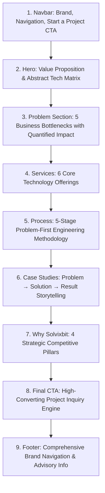

# SOLVIXBIT — Homepage Architecture & Implementation Guide

**Brand:** SOLVIXBIT  
**Tagline:** Technology That Solves.  
**Document Version:** 6.0.0 (Phase 6: Homepage Implementation)  
**Status:** Implemented & Verified  

---

## 1. Homepage Strategic Core

> **"We don't just build software. We solve business problems with technology."**

The SOLVIXBIT homepage is structured as an authoritative, high-conversion flagship interface that differentiates the brand from generic development agencies by focusing on problem diagnosis, purpose-built engineering, and measurable scale.

---

## 2. Section Breakdown & Content Architecture

### Detailed Section Specs

1. **Navbar:** Sticky header, responsive navigation links (`Services`, `Solutions`, `Process`, `Work`, `Why Us`, `Contact`), mobile hamburger menu, and primary CTA (`Start a Project`).
2. **Hero:**
   - *Eyebrow:* `TECHNOLOGY SOLUTIONS`
   - *H1:* `Technology That Solves.`
   - *Subtext:* `We design and build software, AI, automation and digital solutions that help businesses work smarter, move faster and scale with confidence.`
   - *Actions:* Primary `Start a Project` + Secondary `Explore Services`.
   - *Visual:* Abstract engineering telemetry matrix showing diagnostic, architecture, and outcome nodes.
3. **Problem Section:**
   - *Headline:* `Your technology should solve problems — not create more of them.`
   - *5 Business Problem Cards:*
     1. `Manual processes` (Wastes 20+ hours/week per operator)
     2. `Disconnected systems` (Delayed decision making & data silos)
     3. `Outdated platforms` (High maintenance costs & security risks)
     4. `Inefficient workflows` (Lost revenue & extended time-to-market)
     5. `Difficult customer experiences` (Sub-optimal conversion & lower LTV)
4. **Services Grid:**
   - `Software Engineering`, `AI & Automation`, `SaaS & Digital Products`, `Web & Ecommerce`, `Mobile Applications`, `Cloud & Integrations`.
5. **Process (5-Stage Method):**
   - `01 / Discover` → `02 / Design` → `03 / Build` → `04 / Launch` → `05 / Scale`.
6. **Case Studies:**
   - *Logistics AI Platform:* Problem → Solution → +45% Delivery Efficiency.
   - *B2B FinTech Platform:* Problem → Solution → 99.99% Uptime ($450M Volume).
   - *Headless Commerce:* Problem → Solution → +82% Conversion Rate.
7. **Why SOLVIXBIT:**
   - *Pillars:* Problem-first thinking, Purpose-built technology, Scalable architecture, Long-term partnership.
8. **Final CTA:**
   - *Headline:* `Have a problem worth solving?`
   - *Subtext:* `Let's build the technology that solves it.`
   - *CTA Button:* `Let's Solve It →` (opens interactive project inquiry modal).
9. **Footer:**
   - Complete navigation categories, contact information, global advisory hub links, and copyright text.

---

## 3. Accessibility, Performance & Compliance

- **WCAG 2.2 AA:** Verified semantic `<header>`, `<main>`, `<nav>`, `<section>`, `<footer>`, visible focus states, ARIA modal attributes (`role="dialog"`, `aria-modal="true"`, `aria-invalid`), and high-contrast text color combinations.
- **Theme Support:** Instant toggle between Dark (`#070B14`) and Light (`#FFFFFF`) themes via CSS variables.
- **Micro-Interactions:** GPU-accelerated reveals, hover states, and complete `prefers-reduced-motion` compliance.
