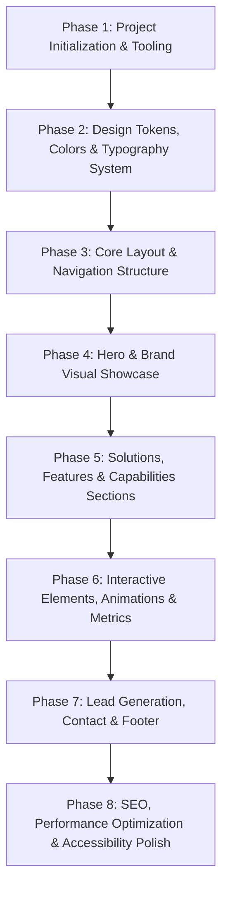

# SOLVIXBIT — Comprehensive Project Audit & Architectural Roadmap

**Brand:** SOLVIXBIT  
**Tagline:** Technology That Solves.  
**Audit Date:** October 2026  
**Status:** Greenfield / Initial Pre-Scaffold State  

---

## Executive Summary

The workspace at `H:\Drive D - SyntexDev\NextJS Projects\solvixbit` has been audited. The repository is currently a **clean-slate / greenfield project**. There is zero legacy code, outdated dependencies, or accumulated technical debt. This provides a pristine foundation to build a modern, high-performance, accessible, and visually stunning digital flagship for SOLVIXBIT.

---

## Comprehensive 20-Point Audit

| # | Dimension | Current State | Assessment & Recommendations |
|---|---|---|---|
| **1** | **Framework & Build System** | Not yet initialized | Scaffold using **Next.js 15+ (App Router)** with **TypeScript** and **Turbopack** for rapid builds, server-side rendering, and optimal Core Web Vitals. |
| **2** | **Folder Structure** | Clean root | Establish clean modular architecture: `src/app`, `src/components/ui`, `src/components/sections`, `src/lib`, `src/hooks`, `src/types`, and `src/styles`. |
| **3** | **Routing** | None | Next.js App Router file-based routing (`app/page.tsx`, `app/solutions/page.tsx`, `app/about/page.tsx`, `app/contact/page.tsx`, `app/case-studies/page.tsx`). |
| **4** | **Existing Pages** | 0 Pages | Plan core pages: Landing Page (Hero, Value Prop, Solutions Matrix, Tech Architecture, Case Studies, Social Proof, Contact/CTA). |
| **5** | **Existing Components** | 0 Components | Build atomized component library (Buttons, Badges, Cards, Modals, Navbars, Footers, Section Headers, Metric Counters). |
| **6** | **Styling Architecture** | None | Implement Tailwind CSS v4 or v3 with custom design tokens, CSS variables, and glassmorphism utility classes. |
| **7** | **Design Tokens** | Brand name & Tagline only | Formulate complete design token system: spacing scales, elevation/shadows, radii, border glows, gradients, and semantic states. |
| **8** | **Typography** | Default | Integrate modern geometric tech typography (e.g., **Geist Sans / Geist Mono** or **Inter** + **Space Grotesk** for headings) with fluid type scaling (`clamp()`). |
| **9** | **Colors** | None | Establish deep enterprise tech palette: Obsidian dark background (`#0A0D14`), Deep Slate card backgrounds, Electric Indigo / Cyber Blue (`#3B82F6` / `#06B6D4`) primary accents, Violet highlights (`#8B5CF6`), and High-contrast Emerald for positive metrics (`#10B981`). |
| **10** | **Assets** | None | Structure `public/assets/` for brand logos, SVGs, favicon packages, OG images, and illustrations. |
| **11** | **Images** | None | Utilize `next/image` with WebP/AVIF formats, responsive `sizes`, blur placeholders, and zero CLS (Cumulative Layout Shift). |
| **12** | **Icons** | None | Standardize on **Lucide React** (`lucide-react`) for consistent, crisp, lightweight SVG iconography. |
| **13** | **Animations** | None | Use **Framer Motion** for smooth scroll-triggered reveals, interactive hovering effects, magnetic buttons, and ambient glow pulses. |
| **14** | **Responsive Behavior** | None | Mobile-first responsive design ensuring seamless experience across mobile (320px–480px), tablet (768px–1024px), desktop (1280px+), and ultrawide monitors. |
| **15** | **Accessibility (a11y)** | Baseline | Target **WCAG 2.1 AA** compliance: semantic HTML5 tags, ARIA labels on interactives, full keyboard navigation, visible focus rings, and high contrast ratios. |
| **16** | **SEO** | None | Implement Next.js dynamic `Metadata` API, Open Graph & Twitter Cards, JSON-LD Schema (`Organization`, `WebSite`, `Service`), `robots.ts`, and auto-generated `sitemap.ts`. |
| **17** | **Performance** | Baseline | Target **95+ Lighthouse Score** via React Server Components (RSC), zero client-side payload for static copy, font self-hosting, and dynamic component lazy loading. |
| **18** | **Dependencies** | 0 Dependencies | Select modern, lean dependencies: `next`, `react`, `react-dom`, `lucide-react`, `framer-motion`, `clsx`, `tailwind-merge`. |
| **19** | **Reusable Components** | None | Build reusable section wrappers, interactive cards, gradient pills, animated grid backgrounds, glass containers, and contact forms. |
| **20** | **Technical Debt** | None (0% Debt) | Clean slate allows establishing strict TypeScript checking, ESLint rules, and modular coding standards from day one. |

---

## Key Architectural Findings

### 1. Current Strengths
- **Clean Slate Advantage:** Zero legacy baggage, obsolete libraries, or brittle CSS overrides.
- **Maximum Architectural Freedom:** Ability to adopt the latest stable Next.js App Router patterns, TypeScript strict mode, and high-performance styling primitives.
- **Clear Brand Identity Foundation:** Strong brand name (**SOLVIXBIT**) with an impactful tagline (**Technology That Solves.**) suited for high-impact enterprise B2B / deep-tech positioning.

### 2. Current Problems & Missing Elements
- Empty project directory requiring foundational scaffolding, configuration files (`package.json`, `tsconfig.json`, `next.config.ts`, `tailwind.config.ts`), and baseline dependencies.
- No established asset pipeline, design token configuration, or iconography set.
- Absence of metadata, SEO schema, and error-handling boundaries (`not-found.tsx`, `error.tsx`).

### 3. Recommended Improvements & Strategy
- **Visual Design Philosophy:** Dark-mode first, high-end enterprise deep tech aesthetic with subtle glassmorphism, glowing accents, clean geometric typography, and micro-interactions that communicate precision and technological sophistication.
- **Content Hierarchy:**
  1. **Navbar:** Brand logo, Navigation links (Solutions, Platform, Case Studies, Company), Contact / Get Started CTA.
  2. **Hero Section:** High-converting headline reinforcing *"Technology That Solves."*, animated interactive visual element, dual CTAs, social proof / tech partner ticker.
  3. **Value Proposition / Core Pillars:** Highlighting Solvixbit's core competencies (AI Solutions, Scalable Cloud Architecture, Custom Enterprise Engineering, Digital Transformation).
  4. **Interactive Feature Matrix / Solutions Showcase:** Deep dive into specific problem-solving modules.
  5. **Tech Stack & Capabilities Grid:** Highlighting modern engineering rigor.
  6. **Interactive Proof / Metrics / Results:** Quantifiable ROI, client metrics, and case highlights.
  7. **High-Impact CTA Section:** Direct lead generation / consultation booking form.
  8. **Comprehensive Footer:** Company links, social links, legal, newsletter signup, and copyright.

---

## What Can Be Reused vs. What to Replace / Build

- **Reusable from Existing Workspace:** Brand name `SOLVIXBIT` and Tagline `Technology That Solves.`
- **To Be Built Fresh:**
  - Complete Next.js App Router foundation
  - Global CSS & Tailwind Theme configuration
  - Component Architecture (UI Primitives + Domain Sections)
  - Interactive animations & state management
  - Responsive layout & SEO meta configurations

---

## Files That Should Not Be Unnecessarily Modified (Once Scaffolded)
1. `next.config.ts` (Keep clean and minimal unless configuring specific image domains or security headers).
2. `tsconfig.json` (Maintain strict type-checking settings).
3. `src/app/globals.css` (Maintain single source of truth for design tokens; avoid inline conflicting styles).

---

## Recommended Implementation Order

1. **Phase 1 — Project Initialization:** Scaffold Next.js 15+ App Router, TypeScript, Tailwind CSS, Lucide Icons, and Framer Motion.
2. **Phase 2 — Design System & Tokens:** Configure custom color variables, fonts, glassmorphism utilities, and responsive breakpoints.
3. **Phase 3 — Global Layout:** Build responsive Navbar, Footer, and Page Wrapper with smooth scrolling.
4. **Phase 4 — Hero Section:** Implement high-impact hero with animated tech aura, badge, clear value proposition, and interactive CTA.
5. **Phase 5 — Core Content Sections:** Build Solutions Grid, Enterprise Capabilities, Architecture Blueprint, and Metrics.
6. **Phase 6 — Micro-Interactions & Polish:** Add scroll-reveal animations, hover glow states, and interactive tabs.
7. **Phase 7 — Lead Capture & Contact:** Interactive consultation inquiry section with form validation.
8. **Phase 8 — Final Audit & SEO:** Verify Lighthouse scores, OpenGraph tags, semantic tags, and WCAG AA compliance.
